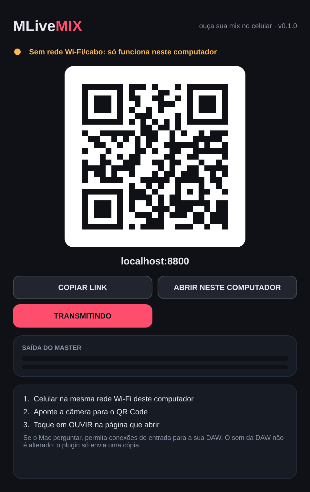
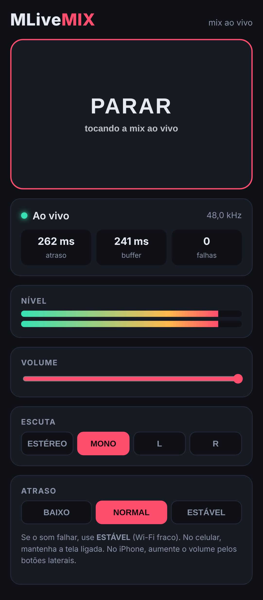

# MLiveMIX

Ouça a mix da sua DAW **ao vivo no celular** (ou em qualquer navegador da sua rede), sem exportar
bounce e sem instalar aplicativo. Coloque o plugin no Master, escaneie o QR Code e toque em **OUVIR**.

| Plugin | Celular |
|---|---|
|  |  |

Formatos: **AU** e **VST3** (macOS Universal: Apple Silicon + Intel), **VST3** (Windows / Linux) e Standalone.
Feito em C++ com [JUCE 8](https://juce.com).

## Como usar

1. Coloque o **MLiveMIX** no **último slot do Master** da DAW (Logic, Ableton, Cubase, REAPER,
   Studio One, FL Studio…; Pro Tools ainda não — veja Limitações).
2. Abra a janela do plugin. Aparece um **QR Code** com o endereço da sua rede (ex.: `192.168.0.15:8800`).
3. Com o celular **no mesmo Wi-Fi**, aponte a câmera para o QR Code e toque em **OUVIR**.
4. Para ouvir no próprio computador (Chrome/Safari), clique em **ABRIR NESTE COMPUTADOR**.

O som da DAW **não é alterado**: o plugin deixa o áudio passar intacto e só envia uma cópia.
Na primeira vez, o macOS pode perguntar se a DAW pode **aceitar conexões de entrada**: clique em **Permitir**.

### Na página do celular

- **OUVIR / PARAR**, volume e medidor de nível L/R.
- **ESCUTA:** ESTÉREO, MONO, só L ou só R — para conferir a tradução da mix.
- **ATRASO:** BAIXO (~0,15 s), NORMAL (~0,25 s) ou ESTÁVEL (~0,6 s, para Wi-Fi fraco).
- Reconecta sozinha se a rede cair ou se a DAW for reaberta.
- No iPhone, toca mesmo com a chave de silencioso ligada. Mantenha a tela ligada enquanto ouve.

## Escuta remota (internet)

Na aba **REMOTO (INTERNET)** do plugin:

1. Clique em **INICIAR TRANSMISSÃO**.
2. **COPIAR LINK** e mande por WhatsApp (ou mostre o QR Code).
3. A pessoa abre o link de qualquer lugar e toca em **OUVIR**.

- O link é **fixo por projeto**: mande uma vez, vale sempre. **NOVO LINK** invalida o anterior.
- Só quem tem o link ouve (o link tem 128 bits aleatórios) e só este plugin consegue transmitir
  nele (chave secreta guardada no projeto).
- O áudio só sai do computador enquanto há alguém ouvindo; atraso típico de 0,5–1 s.

Como funciona: o plugin faz uma conexão **de saída** (funciona atrás de qualquer roteador) para um
servidor na nuvem (`relay/`, Cloudflare Workers + Durable Objects), que repassa o áudio aos ouvintes.

### Publicar o servidor (uma vez)

1. Crie uma conta gratuita em [dash.cloudflare.com](https://dash.cloudflare.com) e, em **Workers & Pages**,
   escolha o seu subdomínio `*.workers.dev`.
2. Crie um token em **My Profile → API Tokens → Create Token → "Edit Cloudflare Workers"**.
3. No GitHub: **Settings → Secrets and variables → Actions**:
   - secret `CLOUDFLARE_API_TOKEN` = o token;
   - variável `CLOUDFLARE_ACCOUNT_ID` = o Account ID (painel da Cloudflare).
4. Rode o workflow **Relay (Cloudflare)** (aba Actions). Ele testa, publica e mostra o endereço.
5. Crie a variável `MLIVEMIX_RELAY_URL` com esse endereço. Os próximos builds do plugin já saem
   com o Remoto apontando para ele.

O plano gratuito da Cloudflare cobre várias horas de transmissão por dia; o plano pago custa US$ 5/mês.

## Como funciona

```
DAW Master ──► MLiveMIX (áudio passa intacto) ──► DAW continua tocando normalmente
                    │
                    └─ cópia (fila sem travas) ─► servidor embutido (porta 8800)
                                                    ├─ GET /      página do player
                                                    ├─ GET /ws    áudio ao vivo (WebSocket, PCM 16 bits)
                                                    └─ GET /status
```

- Áudio sem compressão (PCM 16 bits, taxa da sessão) em pacotes de 20 ms: qualidade de CD ou melhor,
  cerca de 1,5 Mbit/s por ouvinte — tranquilo para qualquer Wi-Fi doméstico.
- Vários ouvintes ao mesmo tempo; um celular lento ou com tela apagada não atrapalha os outros
  nem a DAW (cada ouvinte tem sua própria fila).
- Várias instâncias: cada uma usa a próxima porta livre (8800, 8801, …).

## Instalar

Baixe a versão mais recente em **[Releases](https://github.com/davisalesdsc/MLiveMIX/releases/latest)**.

**macOS:** abra o `MLiveMIX-vX.Y.Z-macOS.pkg`. O instalador ainda não é assinado pela Apple: se o macOS
bloquear, vá em **Ajustes do Sistema → Privacidade e Segurança → Abrir Mesmo Assim**, ou instale pelo Terminal:

```bash
sudo installer -pkg ~/Downloads/MLiveMIX-v0.1.0-macOS.pkg -target /
```

**Windows:** copie `MLiveMIX.vst3` para `C:\Program Files\Common Files\VST3\`.

## Limitações desta versão (0.1)

- **Saída direta para Bluetooth/fone secundário** a partir do plugin está no roteiro. Hoje dá para usar
  o Chrome do Mac com o fone Bluetooth conectado ao Mac.
- Pro Tools exige formato AAX (precisa de conta de desenvolvedor Avid).
- Wi-Fi com "isolamento de clientes" (redes de hotel/empresa) bloqueia a conexão celular ↔ computador.

## Compilar e testar

```bash
cmake -B build -DCMAKE_BUILD_TYPE=Release
```

```bash
cmake --build build --config Release
```

```bash
./build/MLiveMixTests_artefacts/Release/MLiveMixTests
```

Os testes cobrem SHA-1/WebSocket (vetores da RFC), envio de áudio **amostra por amostra idêntico**,
ouvinte travado não atrasando os outros, desconexões bruscas sem derrubar o processo, áudio da DAW
bit a bit intacto e salvar/restaurar estado. Teste no navegador real (Chromium):

```bash
./build/MLiveMixTests_artefacts/Release/MLiveMixTests --serve 25 18900 &
```

```bash
node tests/browser-e2e.js 18900
```

## Créditos

- QR Code: [qrcodegen](https://github.com/nayuki/QR-Code-generator) de Project Nayuki (MIT), em `third_party/qrcodegen`.
